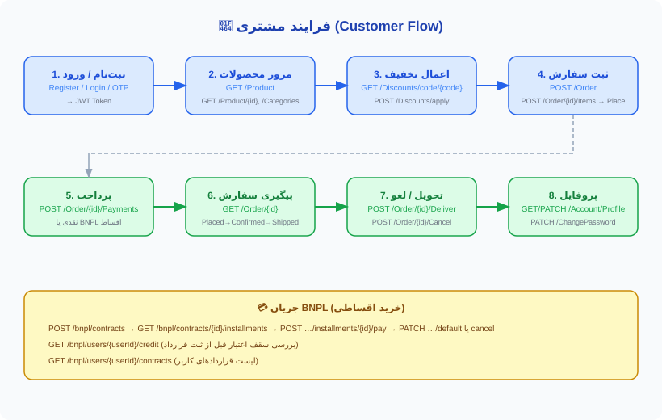
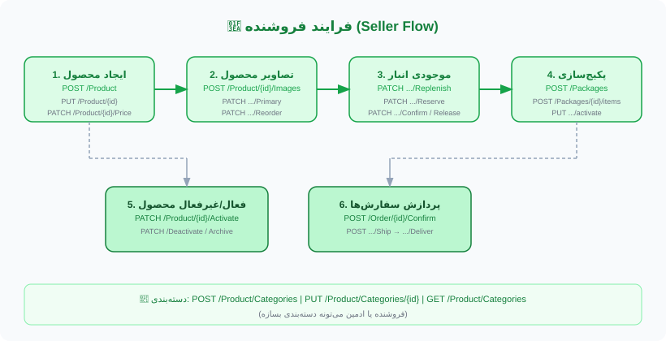
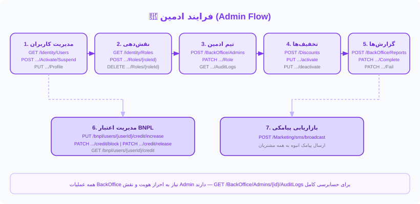
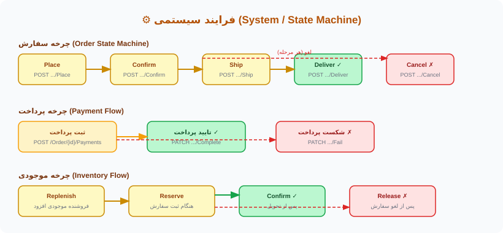

# Ahmad.OnlineShop

پروژه فروشگاه آنلاین بر پایه **.NET 8** با معماری **DDD + Clean Architecture + CQRS**.

---

## فناوری‌ها

| لایه | ابزار |
|---|---|
| Backend | ASP.NET Core 8 Minimal API |
| ORM | EF Core 8 — SQL Server |
| Auth | JWT Bearer + OTP (Bale SMS) |
| Pattern | CQRS (MediatR) + DDD |
| Validation | FluentValidation |
| Frontend | React 18 + TypeScript + Vite + Tailwind CSS |
| State | Zustand (persisted) |
| Data Fetching | TanStack React Query |

---

## ساختار پروژه

```
Src/
├── Domain/          ← Entities, Value Objects, Domain Events
├── Application/     ← Commands, Queries, Handlers, Validators
├── Infrastructure/  ← EF Core, Repositories, External Services
├── Rest/            ← Minimal API Endpoints
└── Host/            ← Program.cs, DI, Middleware

فرانت/               ← React SPA (Admin Panel)
```

---

## فرایندها به تفکیک نقش (Role Flows)

### 👤 مشتری (Customer)


### 🏪 فروشنده (Seller)


### 🔑 ادمین (Admin)


### ⚙️ سیستمی / State Machine


---

## UI/UX — صفحات فرانت

### احراز هویت
| صفحه | مسیر | توضیح |
|---|---|---|
| **LoginPage** | `/login` | ورود دو مرحله‌ای — شماره موبایل → OTP → JWT |

### پنل ادمین
| صفحه | مسیر | توضیح |
|---|---|---|
| **AdminDashboard** | `/admin` | داشبورد اصلی — آمار کلی سیستم |
| **AdminProducts** | `/admin/products` | مدیریت محصولات — ایجاد، ویرایش، فعال/غیرفعال |
| **AdminOrders** | `/admin/orders` | مدیریت سفارشات — تأیید، ارسال، تحویل |
| **AdminUsers** | `/admin/users` | مدیریت کاربران — فعال/تعلیق، نقش |
| **AdminBnpl** | `/admin/bnpl` | مدیریت اقساط — قراردادها، اعتبار |
| **AdminMarketing** | `/admin/marketing` | بازاریابی — ارسال پیامک انبوه |
| **AdminReports** | `/admin/reports` | گزارش‌ها — درخواست و پیگیری |

### Flow اصلی کاربر
```
موبایل → RequestOtp → دریافت SMS (Bale) → VerifyOtp → JWT Token → دسترسی
```

---

## API Endpoints

> Base URL: `https://localhost:{port}/api/v1`
> Auth: `Authorization: Bearer <token>`

---

### 🔐 Identity — احراز هویت

| Method | Route | Auth | توضیح |
|---|---|---|---|
| `POST` | `/Identity/Auth/RequestOtp` | ❌ | ارسال کد OTP به موبایل |
| `POST` | `/Identity/Auth/VerifyOtp` | ❌ | تأیید OTP → دریافت JWT |
| `POST` | `/Identity/Auth/RefreshToken` | ❌ | تمدید توکن با RefreshToken |
| `POST` | `/Identity/Auth/Logout` | ✅ | خروج و باطل کردن توکن |

---

### 👤 Identity — کاربران (Admin)

| Method | Route | Auth | توضیح |
|---|---|---|---|
| `GET` | `/Identity/Users` | ✅ Admin | لیست کاربران |
| `GET` | `/Identity/Users/{id}` | ✅ Admin | اطلاعات یک کاربر |
| `GET` | `/Identity/Roles` | ✅ Admin | لیست نقش‌ها |
| `POST` | `/Identity/Users/{id}/Roles/{roleId}` | ✅ Admin | اضافه کردن نقش |
| `DELETE` | `/Identity/Users/{id}/Roles/{roleId}` | ✅ Admin | حذف نقش |
| `PUT` | `/Identity/Users/{id}/Activate` | ✅ Admin | فعال‌سازی کاربر |
| `PUT` | `/Identity/Users/{id}/Deactivate` | ✅ Admin | غیرفعال‌سازی کاربر |
| `PUT` | `/Identity/Users/{id}/Suspend` | ✅ Admin | تعلیق کاربر |
| `PUT` | `/Identity/Users/{id}/Profile` | ✅ Admin | ویرایش پروفایل کاربر |

---

### 🏦 Account — حساب کاربری

| Method | Route | Auth | توضیح |
|---|---|---|---|
| `GET` | `/Account/` | ✅ | لیست حساب‌های کاربر |
| `GET` | `/Account/{accountNo}/Conditions` | ✅ | شرایط برداشت حساب |
| `POST` | `/Account/Register` | ❌ | ثبت‌نام کاربر |
| `POST` | `/Account/Login` | ❌ | ورود کاربر |
| `POST` | `/Account/RefreshToken` | ❌ | تمدید توکن |
| `POST` | `/Account/Logout` | ✅ | خروج |
| `GET` | `/Account/Profile` | ✅ | دریافت پروفایل |
| `PUT` | `/Account/Profile` | ✅ | ویرایش پروفایل |
| `PUT` | `/Account/ChangePassword` | ✅ | تغییر رمز عبور |

---

### 🛒 Order — سفارشات

| Method | Route | Auth | توضیح |
|---|---|---|---|
| `GET` | `/Order/` | ✅ | لیست سفارشات |
| `GET` | `/Order/{id}` | ✅ | اطلاعات یک سفارش |
| `POST` | `/Order/` | ✅ | ایجاد سفارش جدید |
| `POST` | `/Order/{id}/Items` | ✅ | اضافه کردن آیتم |
| `DELETE` | `/Order/{id}/Items/{itemId}` | ✅ | حذف آیتم |
| `PUT` | `/Order/{id}/Place` | ✅ | ثبت نهایی سفارش |
| `PUT` | `/Order/{id}/Confirm` | ✅ Admin | تأیید سفارش |
| `PUT` | `/Order/{id}/Ship` | ✅ Admin | ارسال سفارش |
| `PUT` | `/Order/{id}/Deliver` | ✅ Admin | تحویل سفارش |
| `PUT` | `/Order/{id}/Cancel` | ✅ | لغو سفارش |
| `POST` | `/Order/{id}/Payments` | ✅ | ثبت پرداخت |
| `PUT` | `/Order/{id}/Payments/{paymentId}/Complete` | ✅ | تأیید پرداخت |
| `PUT` | `/Order/{id}/Payments/{paymentId}/Fail` | ✅ | شکست پرداخت |

---

### 📦 Product — محصولات

| Method | Route | Auth | توضیح |
|---|---|---|---|
| `GET` | `/Product/` | ❌ | لیست محصولات |
| `GET` | `/Product/{id}` | ❌ | اطلاعات محصول |
| `POST` | `/Product/` | ✅ Admin | ایجاد محصول |
| `PUT` | `/Product/{id}` | ✅ Admin | ویرایش محصول |
| `PUT` | `/Product/{id}/Price` | ✅ Admin | تغییر قیمت |
| `PUT` | `/Product/{id}/Activate` | ✅ Admin | فعال‌سازی |
| `PUT` | `/Product/{id}/Deactivate` | ✅ Admin | غیرفعال‌سازی |
| `PUT` | `/Product/{id}/Archive` | ✅ Admin | آرشیو کردن |
| `GET` | `/Product/{id}/Inventory` | ✅ | موجودی انبار |
| `PUT` | `/Product/{id}/Inventory/Replenish` | ✅ Admin | افزایش موجودی |
| `PUT` | `/Product/{id}/Inventory/Reserve` | ✅ | رزرو موجودی |
| `PUT` | `/Product/{id}/Inventory/Release` | ✅ | آزاد کردن موجودی |
| `PUT` | `/Product/{id}/Inventory/Confirm` | ✅ Admin | تأیید موجودی |
| `GET` | `/Product/{id}/Images` | ❌ | لیست تصاویر |
| `POST` | `/Product/{id}/Images` | ✅ Admin | اضافه کردن تصویر |
| `DELETE` | `/Product/{id}/Images/{imageId}` | ✅ Admin | حذف تصویر |
| `PUT` | `/Product/{id}/Images/{imageId}/Primary` | ✅ Admin | تصویر اصلی |
| `PUT` | `/Product/{id}/Images/{imageId}/Reorder` | ✅ Admin | ترتیب تصاویر |
| `GET` | `/Product/Categories` | ❌ | لیست دسته‌بندی‌ها |
| `POST` | `/Product/Categories` | ✅ Admin | ایجاد دسته‌بندی |
| `PUT` | `/Product/Categories/{id}` | ✅ Admin | ویرایش دسته‌بندی |

---

### 🏷️ Discount — تخفیف‌ها

| Method | Route | Auth | توضیح |
|---|---|---|---|
| `GET` | `/Discounts` | ✅ Admin | لیست تخفیف‌ها |
| `GET` | `/Discounts/{id}` | ✅ Admin | اطلاعات تخفیف |
| `GET` | `/Discounts/code/{code}` | ✅ | دریافت تخفیف با کد |
| `POST` | `/Discounts` | ✅ Admin | ایجاد تخفیف |
| `PUT` | `/Discounts/{id}/activate` | ✅ Admin | فعال‌سازی |
| `PUT` | `/Discounts/{id}/deactivate` | ✅ Admin | غیرفعال‌سازی |
| `POST` | `/Discounts/apply` | ✅ | اعمال کد تخفیف |

**پکیج‌ها:**

| Method | Route | Auth | توضیح |
|---|---|---|---|
| `GET` | `/Packages` | ✅ | لیست پکیج‌ها |
| `GET` | `/Packages/{id}` | ✅ | اطلاعات پکیج |
| `POST` | `/Packages` | ✅ Admin | ایجاد پکیج |
| `POST` | `/Packages/{id}/items` | ✅ Admin | اضافه کردن آیتم به پکیج |
| `PUT` | `/Packages/{id}/activate` | ✅ Admin | فعال‌سازی پکیج |
| `PUT` | `/Packages/{id}/deactivate` | ✅ Admin | غیرفعال‌سازی پکیج |

---

### 💳 BNPL — خرید اقساطی

| Method | Route | Auth | توضیح |
|---|---|---|---|
| `POST` | `/Bnpl/Contracts` | ✅ | ایجاد قرارداد اقساط |
| `GET` | `/Bnpl/Contracts/{id}` | ✅ | اطلاعات قرارداد |
| `GET` | `/Bnpl/Users/{userId}/Contracts` | ✅ Admin | قراردادهای یک کاربر |
| `GET` | `/Bnpl/Contracts/{id}/Installments` | ✅ | لیست اقساط |
| `POST` | `/Bnpl/Contracts/{id}/Installments/{installmentId}/Pay` | ✅ | پرداخت قسط |
| `PUT` | `/Bnpl/Contracts/{id}/Default` | ✅ Admin | نکول قرارداد |
| `PUT` | `/Bnpl/Contracts/{id}/Cancel` | ✅ | لغو قرارداد |
| `GET` | `/Bnpl/Users/{userId}/Credit` | ✅ | سقف اعتبار |
| `PUT` | `/Bnpl/Users/{userId}/Credit/Increase` | ✅ Admin | افزایش اعتبار |
| `PUT` | `/Bnpl/Users/{userId}/Credit/Block` | ✅ Admin | مسدود کردن اعتبار |
| `PUT` | `/Bnpl/Users/{userId}/Credit/Release` | ✅ Admin | آزادسازی اعتبار |

---

### 🏢 BackOffice — مدیریت ادمین‌ها

| Method | Route | Auth | توضیح |
|---|---|---|---|
| `GET` | `/BackOffice/Admins` | ✅ SuperAdmin | لیست مدیران |
| `GET` | `/BackOffice/Admins/{id}` | ✅ SuperAdmin | اطلاعات مدیر |
| `POST` | `/BackOffice/Admins` | ✅ SuperAdmin | ایجاد مدیر جدید |
| `PUT` | `/BackOffice/Admins/{id}/Activate` | ✅ SuperAdmin | فعال‌سازی |
| `PUT` | `/BackOffice/Admins/{id}/Deactivate` | ✅ SuperAdmin | غیرفعال‌سازی |
| `PUT` | `/BackOffice/Admins/{id}/Suspend` | ✅ SuperAdmin | تعلیق |
| `PUT` | `/BackOffice/Admins/{id}/Role` | ✅ SuperAdmin | تغییر نقش |
| `GET` | `/BackOffice/Admins/{id}/AuditLogs` | ✅ SuperAdmin | لاگ فعالیت‌ها |
| `GET` | `/BackOffice/Reports` | ✅ Admin | لیست گزارش‌ها |
| `POST` | `/BackOffice/Reports` | ✅ Admin | درخواست گزارش |
| `PUT` | `/BackOffice/Reports/{id}/Complete` | ✅ Admin | تکمیل گزارش |
| `PUT` | `/BackOffice/Reports/{id}/Fail` | ✅ Admin | شکست گزارش |

---

### 📣 Marketing — بازاریابی

| Method | Route | Auth | توضیح |
|---|---|---|---|
| `POST` | `/Marketing/sms/broadcast` | ✅ Admin | ارسال پیامک انبوه به همه مشتریان |

---

## راه‌اندازی

```bash
# دیتابیس
dotnet ef database update --project Src/Infrastructure/...

# اجرا
dotnet run --project Src/Host/Ahmad.OnlineShop.Option

# فرانت
cd فرانت
npm install
npm run dev
```

## نکات مهم
- SMS از **Bale** استفاده می‌کند — نه Telegram
- `IBaleService.SendMessageAsync(chatId, text)` → `https://tapi.bale.ai`
- در DEV mode کد OTP در response برمی‌گردد
